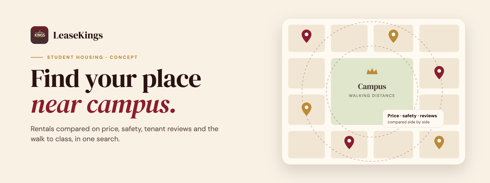
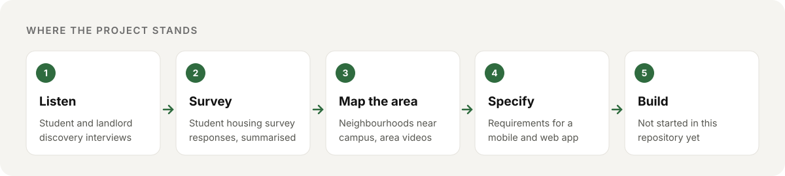

  <picture>
    <source media="(prefers-color-scheme: dark)" srcset=".github/assets/banner-dark.png">
    
  </picture>

  <strong>Student housing search, built around what students actually ask.</strong> 
  LeaseKings is a marketplace concept that helps university students compare nearby rentals on price, safety, reviews and walk to campus, and gives landlords a direct line to student tenants.

  <a href="#what-students-told-us"><strong>Findings</strong></a> ·
  <a href="#the-product-we-specified"><strong>Product spec</strong></a> ·
  <a href="#whats-in-this-repository"><strong>Files</strong></a> ·
  <a href="#honest-status"><strong>Honest status</strong></a>

  
  
  
  

  
   <strong>Conceptual artwork,</strong> generated for this project. Fictional buildings; not real listings.

## Why LeaseKings

Finding off-campus housing is a scramble. Listings are scattered across group chats, generic rental sites and broker inboxes. Photos are out of date, landlords go quiet, and a block that looks close on a map can feel very different at night. Students end up signing leases with less information than they would use to pick a laptop.

**LeaseKings starts from the student's side of the table.** The idea is one search focused on the few neighbourhoods around a campus, with the details students said they need: real photos and layouts, safety context, reviews from past tenants, roommate options and side-by-side comparison. Landlords get a focused channel to students instead of paying for broad listings.

<table>
  <tr>
    <td width="33%" valign="top">
      <h3>📍 Close, and clear</h3>
      Listings on a map of the blocks around campus, with distance and safety context alongside price.
    </td>
    <td width="33%" valign="top">
      <h3>⭐ Trust before you sign</h3>
      Reviews and ratings from past tenants, verified students, and up-to-date photos, layouts and videos.
    </td>
    <td width="33%" valign="top">
      <h3>🏠 Built for students</h3>
      Favourites, side-by-side comparison, alerts for new places and room or roommate options.
    </td>
  </tr>
</table>

## Where the project stands

  

## What students told us

From the team's summary of its customer-discovery interviews and student survey:

| Theme | What came up |
| --- | --- |
| **Deciding factors** | Price, location and amenities first, then safety and security |
| **Pain points** | Unresponsive landlords, dishonest brokers, hard-to-find roommates and a confusing market |
| **Must-haves** | Laundry and a usable kitchen; good security features |
| **Trust signals** | Reviews, personal recommendations and past experience |
| **What they wished for** | One central platform with detailed information, layouts and videos, plus roommate matching and simpler leasing |

## The product we specified

The [requirements document](Requirement%20Specifications.docx) describes a mobile and web app. None of it is built yet.

| Feature | For | Status |
| --- | --- | --- |
| Account sign-up and sign-in (email or social) | Students | 🔜 Specified |
| Property listings with photos, prices and amenities | Landlords | 🔜 Specified |
| Search and filters (location, price, bedrooms, amenities) | Students | 🔜 Specified |
| Map view with property markers | Students | 🔜 Specified |
| Reviews and ratings | Students | 🔜 Specified |
| Favourites and side-by-side comparison | Students | 🔜 Specified |
| Alerts for new listings and messages | Students | 🔜 Specified |
| Student verification and an admin dashboard | Admins | 🔜 Specified |

**How it compares.** Campus listing services such as Places4Students and general rental sites already list student housing. LeaseKings' angle, from the research, is a narrow, neighbourhood-by-neighbourhood focus with more context per listing (safety, tenant reviews, walk-throughs) and a closer relationship with a small set of landlords.

## What's in this repository

| Where | What it is |
| --- | --- |
| [`Customer Discovery/`](Customer%20Discovery) | Interview guides for students, landlords and other founders, interview notes, survey responses and a summary of findings |
| [`Requirement Specifications.docx`](Requirement%20Specifications.docx) | Functional and non-functional requirements for the app |
| [`Roadmap.docx`](Roadmap.docx) | Task tracker for the 2024 discovery work |
| `Business Model Canvas.docx`, `C-Corp Choices.docx` | Business model notes and a comparison of incorporation services |
| `Brokerages.docx`, `Brokerages.xlsx`, `output.csv` | Research on local real-estate brokerages (public business contact details) |
| `Map of Different Regions.docx`, `Areas near USC.png` | Neighbourhood analysis around campus |
| `Feedback to Website.docx`, `Possible Template.docx` | Feedback on an early website draft and no-code template options (the website itself is not in this repository) |
| [`Videos/`](Videos) | Ideas and interview questions for neighbourhood videos |
| `Lease Kings Logo.webp`, [`assets/brand/`](assets/brand/README.md) | Logo and conceptual cover art |

Open the files in any viewer that handles `.docx`, `.xlsx`, `.pdf` and images. There is nothing to install or build.

## Honest status

LeaseKings is in **research and product definition**.

- There is **no app, website or listings database** in this repository.
- The feature list is a **specification**, not shipped functionality.
- Interview notes and survey responses are research records; please respect the people in them.
- The cover image is **AI-generated concept art** and shows fictional buildings.

## License

No license file is included. This README grants no reuse or redistribution rights; contact the repository owner about permitted use.

   
   
  <strong>LeaseKings</strong> · Know the block before you sign.

